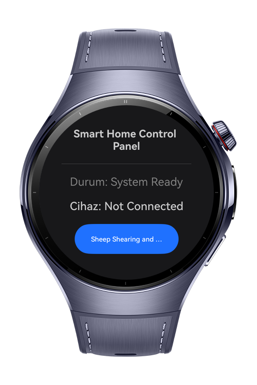

> **Note:** To access all shared projects, get information about environment setup, and view other guides, please visit [Explore-In-HMOS-Wearable Index](https://github.com/Explore-In-HMOS-Wearable/hmos-index).

# HowToControlWithBluetooth

This project is a HarmonyOS (ArkTS) application designed to scan, connect, and control smart lighting devices using the Bluetooth Low Energy (BLE) protocol. It allows users to toggle lights on/off by communicating with specific BLE services and characteristics.
# Preview

<div>


</div>

# Use Cases

Users can control individual or groups of BLE-enabled LED bulbs directly from their HarmonyOS device without needing a central hub or an active internet connection.

Action: Toggle bedside lamps or ceiling lights.

Benefit: Low latency and works during internet outages.

# Tech Stack

Protocol: Bluetooth BLE Module 

Framework: HarmonyOS SDK (ArkTS)

Target Devices: HarmonyOS-enabled smartphones and IoT development boards.

# Directory Structure

```

├───entryability
│       EntryAbility.ets
│       
├───entrybackupability
│       EntryBackupAbility.ets
│       
└───pages
        Index.ets
           
```

# Constraints and Restrictions

## Supported Devices

- Huawei Watch 5
- Devices running HarmonyOS 5.1.0 (API 18) and above

# LICENSE

How-To-Control Smart Lights With Harmonyos And Bluetooth is distributed under the terms of the MIT License
See the [LICENSE](./LICENSE) for more information.
